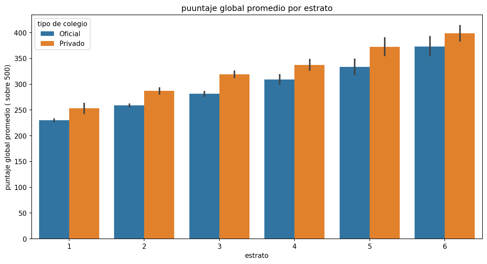
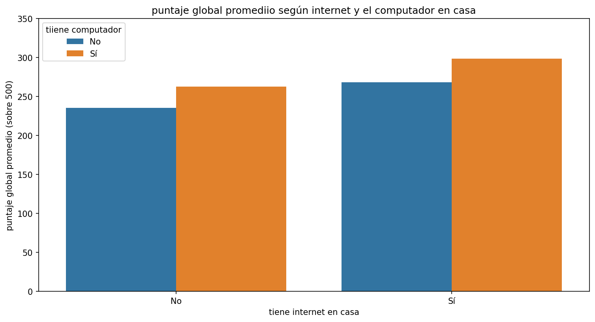
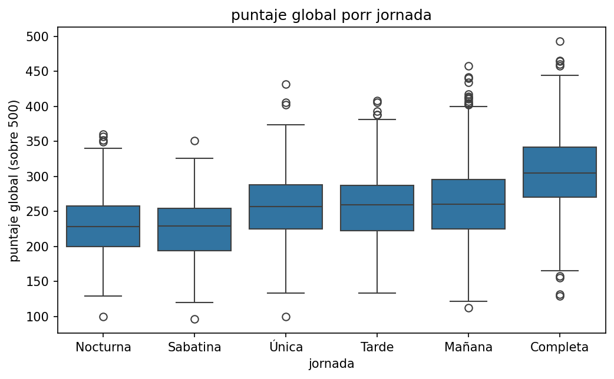
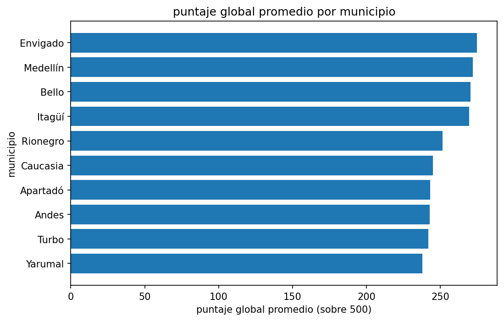
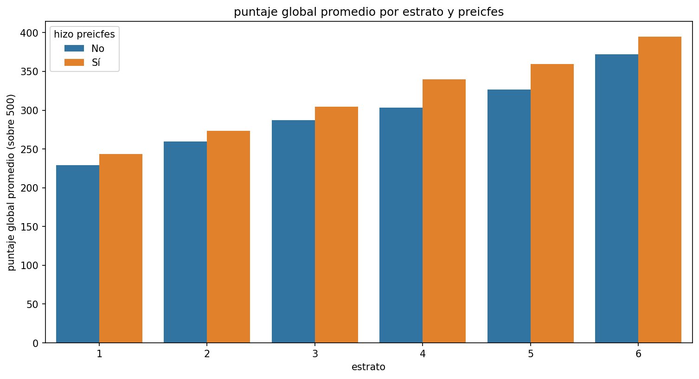
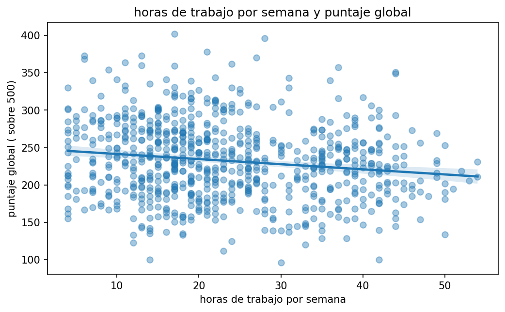

# proyecto-integrador-pc-grupo-6
Educación

## Integrantes 
Juan Manuel Ramirez Ciro y Esteban Villalba Aguirre 

### Resultados saber 11 de estudiantes de Antioquia 2025

 Los datos son sinteticos. El archivo educacion_saber11_antioquia_2025.csv tiene 3.250 filas y 23 columnas. Cada fila es un estudiante.

 | columna | tipo | descripción |
|---|---|---|
| id_estudiante | texto | Identificador  |
| municipio | categorica | municipio_colegio |
| zona | categorica | Urbana o Rural |
| estrato | entero (1-6) | Estrato_vivienda |
| tipo_colegio | categorica | Oficial o privado |
| jornada | categorica | Mañana, Tarde, Única, Completa, Nocturna o Sabatina |
| sexo | categorica | F o M |
| edad | entero | Edad al presentar |
| educacion_madre | categorica  | nivel |
| ingreso_familiar_smmlv | numerica | Ingreso_en_salarios _mínimos |
| acceso_internet | categorica |  internet en casa |
| computador_hogar | categorica | tiene computador en casa |
| trabaja | categorica |  si trabaja además de estudiar |
| horas_trabajo_semana | numerica | Horas de trabajo |
| horas_estudio_semana | numerica |  estudio por fuera de clase a la semana |
| inasistencias_año | numerica | faltas al colegio en el año |
| preparacion_preicfes | categorica |  si tomó curso preicfes |
| puntaje_matematicas | numerica (0-100) | Puntaje en matematicas |
| puntaje_lectura | numerica (0-100) | Puntaje en lectura |
| puntaje_ciencias| numerica (0-100) | Puntaje en ciencias  |
| puntaje_sociales | numerica (0-100) | Puntaje en sociales|
| puntaje_ingles | numerica (0-100) | Puntaje en inglés |
| puntaje_global | entero (0-500) | Puntaje  ponderado |

**¿Que se busca?** la secretaría de educación debe decidir a qué colegios, jornadas o poblaciones dirigir programas de apoyo 

## PREGUNTAS

1.	¿Cómo cambia el puntaje global según el estrato, la zona y el tipo de colegio?
2.	¿Tener internet o computador en casa se asocia con mejores resultados?
3.	¿Los estudiantes que trabajan obtienen puntajes más bajos? ¿Depende de cuántas horas trabajan?
4.	¿Qué jornadas necesitan más apoyo? ¿Quiénes estudian en ellas?
5.	¿Qué municipios y grupos concentran los puntajes más bajos?
6.	¿El preicfes se asocia con mejores puntajes y quién accede a él?

### calidad datos y limpieza 

| columna	| problema |	% afectado | decicion |	justificacion |
|---|---|---|---|---|
| ingreso_familiar_smmlv |	faltantes |	56,77 % |	Eliminar |	Imputar inventaria |
| horas_trabajo_semana |	Faltantes |	76,77 % |	No imputar |vacía si no trabaja|
| horas_estudio_semana	|4 imposibles y faltantes|	8,43 %	|Imposibles a faltantes|	Sesgada a la derecha|
|inasistencias_año|	faltantes|	6,98 %|	mediana por jornada|	Cambia segun la jornada|
|educacion_madre|	Faltantes|	10,58 %|	Moda por estrato	|Categórica|
|acceso_internet|	Faltantes|	2,83 %	|Moda por zona|	Cambia según la zona|
|puntaje_ingles|	Faltantes	|3,75 %|	No imputar	|es un resultado de la prueba|
| edad	|Valores altos |(hasta 44)|	273 mayores de 20|	Conservar|	Son adultos de Nocturna y Sabatina|

### LO QUE SE ENCONTRO 
1.	El puntaje sube con el estrato (232,0 en el 1 y 393,1 en el 6), es mayor en lo urbano (269,2 contra 227,7) y en colegios privados (306,3 contra 251,9).
2.	Con internet y computador el promedio es 298,5 y con ninguno 235,5. Tiene internet el 22,5 % de los rurales y el 56,2 % de los urbanos.
3.	Quienes trabajan promedian 232,3 y quienes no 272,0.
4.	Sabatina (225,1) y Nocturna (230,7) son las jornadas más bajas.
5.	Yarumal (237,7), Turbo (241,9) y Andes (242,7) son los municipios más bajos.
6.	Con preicfes el promedio es 286,6 y sin preicfes 250,8, pero lo tomó sobre todo el estrato alto (92,3 % en el 6 contra 19,8 %

#### como ejecutar el notebook
- Abre el notebook en colab [https://colab.research.google.com/drive/1s6y4pBzMnBuMH_pNorUcOXJep2N5wGZL]
- sube el scv
- En el entorno de ejecución reinicia y ejecuta todo

## Visualizaciones

### 1. puntaje global por estrato y tipo de colegio

### 2. puntaje promedio segun internet y computador en casa

### 3. puntaje global por jornada

### 4. puntaje promedio por municipio

### 5. puntaje por estrato y preicfes

### 6. Horas de trabajo y puntaje

## Conclusiones y recomendaciones

**Respuesta a cada pregunta**

1. Estrato, zona y tipo de colegio: el puntaje sube con el estrato 232 a 393, es mayor en lo urbano 269 contra 227 y en colegios privados 306 contra 251. El grupo mas bajo y numeroso es oficial rural 220; 415 estudiantes.
2. Internet y computador: se asocian con mejores resultados: 298 con ambos y 230 con ninguno. Solo el 22 % de los estudiantes rurales tiene internet, contra el 56 % de los urbanos.
3. Trabajo: quienes trabajan promedian 232 contra 272 de quienes no 39 puntos menos. Entre quienes trabajan, el puntaje baja con las horas 240 con 1 a 15 h y 220 con 31 a 60 h, aunque el efecto de las horas es debil.
4. Jornadas: las que mas apoyo necesitan son Sabatina 225 y Nocturna 230.­ estudian adultos (edad mediana de 30 y 29 años) y trabaja el 69 % y el 75 %.
5. Municipios y grupos: Yarumal, Turbo, Andes, Apartado y Caucasia tienen los promedios mas bajos y entre 33 % y 51 % de estudiantes rurales. El 28 % de los rurales saca menos de 200 puntos, contra el 9 % de los urbanos.
6. Preicfes: se asocia con mas puntaje 286 contra 250 pero parte de esa diferencia se debe al estrato: dentro de cada estrato es de unos 14 a 18 puntos en los estratos 1 a 3. Lo toma el 19 % del estrato 1 y el 92 % del estrato 6.

Recomendaciones para la Secretaria de Educacion

1. Priorizar los colegios oficiales rurales y los municipios de Yarumal, Turbo, Andes, Apartado y Caucasia Respaldo: oficial rural tiene el promedio mas bajo 220 con 415 estudiantes, y el 28 % de los rurales saca menos de 200 puntos.
2. Crear un programa de conectividad (internet y computador) para los hogares que no tienen ninguno. Respaldo: son 1.075 estudiantes 33 % con promedio de 235, 63 puntos menos que quienes tienen ambos; en la zona rural solo el 22 % tiene internet.
3. Ofrecer apoyo con horarios flexibles en las jornadas Nocturna y Sabatina Respaldo: son 320 estudiantes con los puntajes mas bajos 230 y 225, y trabaja entre el 70 % y el 75 %, con una mediana de 21 horas de trabajo por semana.
4. Ofrecer preicfes gratuito a los estratos 1 y 2. Respaldo: son el 74 % de los estudiantes, el preicfes lo toma solo el 19 % del estrato 1 y se asocia con unos 14 puntos mas dentro del mismo estrato.

## Limitaciones

- Datos sinteticos: el dataset no es real, que los resultados sirven para practicar el analisis y no para decidir sobre colegios reales.
- Asociacion no es causa: las diferencias (internet, preicfes, trabajo) son relaciones entre variables y no demuestran que una cause a la otra. Ademas, estrato, zona y tipo de colegio estan relacionados entre si.
- Grupos pequeños: los estratos 5 y 6 (57 y 39 estudiantes), el estrato 6 oficial (9) y Sabatina (106) tienen pocos datos; en el estrato 6 sin preicfes hay solo 3 estudiantes.
- Faltantes e imputaciones: se imputaron 937 valores (horas de estudio, inasistencias, educacio de la madre e internet) y se elimina la columna de ingreso familiar 56 % de faltantes, por eso no se pudo analizar el ingreso. Hay 122 estudiantes sin puntaje de ingles.
- Sin fechas: el dataset corresponde a un solo año (2025), por lo que no se puede ver la evolucion en el tiempo.
- Una sola variable de cada vez: las graficas muestran promedios y relaciones simples; no controlan varias variables al mismo tiempo.

## video explicativo

link en google drive[https://drive.google.com/file/d/1SliGvb6Fjde4mGJRxxaIiqCveI6AF1al/view?usp=sharing]

